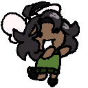

<p align="center">
  
</p>

<h1 align="center">My Cool 3DS Music Player!</h1>

<p align="center">
  A very cool music player for <b>Nintendo 3DS</b> made in C! (by claude code, and google gemini, and chatgpt, and grok, and allat)
</p>

---

## Features!!

- **Audio Formats Support:**
  - **MP3**
  - **WAV**
  - **FLAC (fuck you)**
  - **OGG Vorbis**
  - **Opus (untested)**

- **Lyrics! (`.lrc`):**
  - Automatic download of lyrics files (.lrc) when the console is connected to the internet! (This might fail if your song lacks metadata,,,,)
- **Last.FM**
  - Bcuz we all love Last.FM,,,, no,,,?

## Modding (or something)

<p align="center">
  
</p>

Do u see her,,,? she's my daughter **Agustina!**,,, do u like her? no? well, you have the option to murder her in cold blood and replace her with your favorite character (provided you have the necessary animation skills)

1. Create this folder in ur SD
   ```text
   /3ds/MCMP/mods/
   ```
2. And put ur pngs there! (They need to be 160 × 198)

   | `gustinaNothing1.png` (animation for nothing burger music) |
   | `gustinaNothing2.png` |
   | `gustinaIdle1.png` (animation to be placed between bopleft and bopright) |
   | `gustinaIdle2.png` |
   | `gustinaBopLeft1.png` (bop left) |
   | `gustinaBopLeft2.png` |
   | `gustinaBopLeft3.png` |
   | `gustinaBopRight1.png` (bop rightht) |
   | `gustinaBopRight2.png` |
   | `gustinaBopRight3.png` |

---

## SD routes

- `sdmc:/music/` — ur music!! (and the lrc files)
- `sdmc:/3ds/MCMP/mods/` — uhh mods.
- `sdmc:/3ds/MusicPlayer/lastfm.cfg` — Last.FM acc
- `sdmc:/3ds/MusicPlayer/lfm_queue.txt` — Last.FM history when u are without wifi,,,

---

## How 2 Compile and allat

u need **devkitPro / devkitARM** with `libctru`, `citro2d`, `citro3d`, `opusfile`, `vorbisidec` aaaand `libogg`.

```bash
# Compile .3dsx
make

# Compile cia 
# Requires bannertool and makerom in path
make cia

# clean shii
make clean
```
