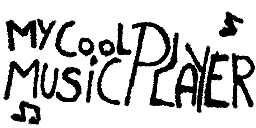

<p align="center">
  
</p>

<h1 align="center">My Cool 3DS Music Player! (i lack the creativity for a better name)</h1>

<p align="center">
  A very cool music player for Nintendo 3DS made in C! (by claude code, and google gemini, and chatgpt, and grok, and allat,,,, not really, just a prank lol)
</p>

---

## Features!!

- **Audio Formats Support:**
  - **MP3**
  - **WAV**
  - **FLAC (fuck you)**
  - **OGG Vorbis**
  - **Opus (untested)**
  - **M4A**
  - **AAC**

- **Lyrics! (`.lrc`):**
  - Automatic download of lyrics files (.lrc) when the console is connected to the internet! (This might fail if your song lacks metadata,,,,)
- **Remembers Ur Stuff:**
  - Saves ur last folder, last song, repeat/shuffle/lyrics toggles, and volumes so u pick up right where u left off!
- **Last.FM**
  - Bcuz we all love Last.FM,,,, no,,,?

## Modding (or something)

<p align="center">
  
</p>

Do u see her,,,? she's my daughter **Agustina!**,,, do u like her? no? well, you have the option to murder her in cold blood and replace her with your favorite character (provided you have the necessary animation skills)

1. Create this folder in ur SD
   ```text
   /3ds/MCMP/mods/
   ```
2. And put ur pngs there! (They need to be 160 × 198)

   | `gustinaNothing1.png` (animation for nothing burger music) |
   | `gustinaNothing2.png` |
   | `gustinaIdle1.png` (animation to be placed between bopleft and bopright) |
   | `gustinaIdle2.png` |
   | `gustinaBopLeft1.png` (bop left) |
   | `gustinaBopLeft2.png` |
   | `gustinaBopLeft3.png` |
   | `gustinaBopRight1.png` (bop rightht) |
   | `gustinaBopRight2.png` |
   | `gustinaBopRight3.png` |

---

## SD routes

- `sdmc:/music/` — ur music!! (and the lrc files)
- `sdmc:/3ds/MCMP/mods/` — uhh mods.
- `sdmc:/3ds/MCMP/cache/` — cached cover thumbnails so Old 3DS doesn't die
- `sdmc:/3ds/MCMP/state.cfg` — remembers ur last song, folder, volumes & toggles!
- `sdmc:/3ds/MusicPlayer/lastfm.cfg` — Last.FM acc
- `sdmc:/3ds/MusicPlayer/lfm_queue.txt` — Last.FM history when u are without wifi,,,

---

## How 2 Downloda!!!

- go to the [releases](https://github.com/mkworldbigfan/MyCoolMusicPlayer/releases) table, ple ase (u can download the cia without the other things, but if u download the .3dsx .elf and .smdh then everything goes together inside MCMP folder)

---

## How 2 Compile and allat

u need **devkitPro / devkitARM** with `libctru`, `citro2d`, `citro3d`, `opusfile`, `vorbisidec` aaaand `libogg`.

```bash
# Compile .3dsx
make

# Compile cia 
# Requires bannertool and makerom in path
make cia

# clean shii
make clean
```

## Credits!!

- **FAAD2** ([knik0/faad2](https://github.com/knik0/faad2)) — decodes AAC & M4A shii (`third_party/faad2`)
- **minimp3** ([lieff/minimp3](https://github.com/lieff/minimp3)) — decodes MP3s (`include/minimp3.h`)
- **dr_wav** & **dr_flac** ([mackron/dr_libs](https://github.com/mackron/dr_libs)) — WAVs and FLACs (fuck you flac) (`include/dr_wav.h`, `include/dr_flac.h`)
- **stb_image** ([nothings/stb](https://github.com/nothings/stb)) — loads ur JPEGs & PNGs for covers and agustina mods! (`include/stb_image.h`)
- **QR Code generator** ([nayuki/QR-Code-generator](https://github.com/nayuki/QR-Code-generator)) — makes the Last.FM QR code (`source/qrcodegen.c`, `include/qrcodegen.h`)
- **devkitPro / libctru / citro2d / citro3d** ([devkitPro/libctru](https://github.com/devkitPro/libctru), [devkitPro/citro2d](https://github.com/devkitPro/citro2d), [devkitPro/citro3d](https://github.com/devkitPro/citro3d)) — 3DS homebrew magic annd rendering
- **Tremor (`ivorbisfile`)**, **opusfile** & **libogg** ([xiph/tremor](https://github.com/xiph/tremor), [xiph/opusfile](https://github.com/xiph/opusfile), [xiph/ogg](https://github.com/xiph/ogg)) — OGG and Opus stuff,,,,
- **bannertool** & **makerom** ([carstene1ns/3ds-bannertool](https://github.com/carstene1ns/3ds-bannertool), [3DSGuy/Project_CTR](https://github.com/3DSGuy/Project_CTR)) — for making the `.cia`aaaand banners!
